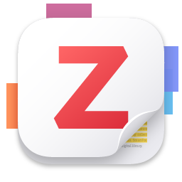

# dsh-zotero-paperbridge

DSH 原生 Host 插件，让 DSH 检索网上文献、查询已有 Zotero 文库，并将用户选定的文献保存到 Zotero。Zotero 端继续使用已安装的应用和接口；无需修改 Zotero 数据库，也不会替换现有 Zotero MCP。

## 安装

从 [GitHub Releases](https://github.com/XZJ-top/dsh-zotero-paperbridge/releases/latest) 下载本包的 `.tgz`，在 DSH 插件管理界面安装。迁移旧包时，先停用旧版 `dsh-zotero`，再启用本包；业务工具名保留原接口，避免同时启用造成重复注册。开发安装可使用包含本目录的本地 package spec。插件遵循 `dsh.manifestVersion: 1` 和 Cordis bundle patch，依赖 Node >=22、`@deepseek-ai/schemastery`。没有安装生命周期脚本。

## 配置

本地模式默认即可运行：打开 Zotero，在设置中启用本地 API（`extensions.zotero.httpServer.localAPI.enabled`），先选中保存目标集合。默认连接 `http://127.0.0.1:23119`，个人文库 `/users/0`，允许保存的本地内部 library ID 为 `1`。如果内部 ID 不同，在 DSH 插件设置中修改 `expectedLocalLibraryId`。它与 zotero.org 的 user ID 不同。

本地模式使用现有 Connector `/connector/saveItems` 写入，并用 Local API 回读。Zotero 10+ 也提供授权的 Local API 写入；本版本仍采用 Connector，不主动触发新的授权窗口。

云端可选配置：

```yaml
- id: dsh-zotero-paperbridge
  config:
    backend: web
    libraryType: users
    libraryId: "你的用户ID"
    apiKeyEnv: ZOTERO_API_KEY
```

在 DSH 凭据设置中配置 `ZOTERO_API_KEY`，或在启动环境提供同名变量。请给 API key 相应文库写权限。群组库用 `libraryType: groups` 及 group ID。云端条目进入桌面 Zotero 需要同步。配置文件中无需放明文密钥。

完整可选配置还包括 `contactEmail`（Crossref 联系邮箱）、`defaultTags`、`timeoutMs`、`maxResponseBytes`、`candidateTtlMinutes`、`maxCandidates`。可在 DSH 插件设置中编辑。

## 使用

直接对 DSH 说：

> 检索宏基因组组装相关文献，列出 DOI、作者、摘要和来源。把我选定的文献保存到 Zotero 当前集合，添加标签 metagenomics，并检查是否重复。

工具：

| 工具 | 用途 |
| --- | --- |
| `zotero_status` | 连接状态、当前集合与 `expectedTarget` |
| `zotero_search` | 网上 Crossref / Europe PMC 检索；与文库搜索分开 |
| `zotero_lookup` | 按 DOI 或 PMID 解析真实元数据 |
| `zotero_library_search` | 已有 Zotero 文库搜索和分页 |
| `zotero_get` | 根据 key 读取完整条目 |
| `zotero_collections` | 列出文库集合，满页时报告截断 |
| `zotero_save` | 保存选定 `candidateIds` 或 `identifiers`，查重并回读 |

检索结果的候选 ID 保存在插件内存中；过期或插件重载后请重新检索，也可直接用 DOI/PMID 保存。保存只能使用此前来源返回的元数据或实时解析的标识符，不接受模型编造的条目 JSON。

`zotero_search` 支持 `source: all/crossref/europepmc`、`limit` 和 `offset`。Crossref 默认筛选期刊论文；按 DOI 解析仍支持其它来源类型。混合检索交替选取来源结果，避免截取结果时丢掉整个来源。Europe PMC 使用分页，偏移按页取整；混合检索先合并去重再截取，因此不是全来源统一游标。单个来源失败会返回 `warnings`，不掩盖成完整结果。

## 保存与验证

- 保存前按规范化 DOI 精确查重。缺少 DOI 时使用 URL 或标题及年份进行明确匹配。搜索命中只是候选，不能直接当作重复。查重扫描超出上限时拒绝保存。
- 插件内部串行写入；相同选择中的重复文献只提交一次。其它客户端同时新增相同 DOI 仍可能产生竞态，Zotero 没有 DOI 唯一约束。
- 本地保存只允许已配置的个人文库；群组写入请用 Web 模式。保存前检查目标是否可写，并可用 `expectedTarget` 拒绝目标变化。
- Connector 写入后不直接得到数据库 key。插件追加唯一 `DSH import ID`，查回条目后读取实际 key，检查标题、DOI 和导入标记，只有一致才设置 `verified: true`。
- `verified` 表示条目身份验证；`targetVerified` 单独表示集合验证。汇总结果的 `allItemsVerified` 和 `allTargetsVerified` 分别反映这两类证据；`allVerified` 仅在身份与集合都确认时为真。明确要求集合但归属不匹配时，保存结果标记为未验证。本地可传 `expectedCollectionKey`，然后检查回读条目确实属于该集合。未提供集合 key 时，选区只能预检查，集合成员验证会报告 `false`。保存期间请保持 Zotero 选择稳定。
- Web 模式支持 `collectionKeys`，逐篇检查正式 API 成功响应并回读。书目类型按来源保留；服务拒绝的字段会返回写入失败，不伪装成功。
- `accepted_unverified` / `saved_unverified` 表示接受或保存后无法完成身份回读；`outcome_unknown` 表示请求已发送但响应未收到。此时先查询文库，避免盲目重试。不会自动重发 POST。
- 保存书目、作者、DOI、日期、来源摘要与追溯信息，默认追加 DSH 标签。当前版本只保存元数据，不自动下载 PDF。原文摘要与 AI 总结不得混为一谈。

## 开发验证

```sh
npm install --ignore-scripts
npm test
npm run check
npm pack
```

测试采用真实本机 HTTP 模拟服务与 Web API 传输替身，覆盖来源失败、元数据保存、查重、目标变化、响应丢失、凭据边界、回读身份、DSH 注册与 disposer。真实文库验证脚本只读，不新增测试文献。

## 参考与许可

本包为原创 MIT 实现，协议参考：[Zotero Connector](https://github.com/zotero/zotero/blob/9.0/chrome/content/zotero/xpcom/server/server_connector.js)、[Web API](https://www.zotero.org/support/dev/web_api/v3/write_requests)、[Crossref REST](https://api.crossref.org)、[Europe PMC REST](https://europepmc.org/RestfulWebService)。

连接设计参考 [XZJ-top/hana-zotero-obsidian-connectors](https://github.com/XZJ-top/hana-zotero-obsidian-connectors)、[XZJ-top/zotero-obsidian-paper-workflow](https://github.com/XZJ-top/zotero-obsidian-paper-workflow)、[54yyyu/zotero-mcp](https://github.com/54yyyu/zotero-mcp)、[evanliu3594/dsh-zotero-plugin](https://github.com/evanliu3594/dsh-zotero-plugin)。没有复制受许可限制的实现代码或 Zotero 应用源码；本版本图标来自 Zotero 官方品牌页面，归属见 NOTICE。

## 官方图标与项目名称

本项目包名及独立仓库名为 `dsh-zotero-paperbridge`，业务工具名保留原有 `zotero_*` 接口。



图标直接下载自 [官方素材](https://www.zotero.org/support/_media/logo/zotero_256x256x32.png)，未修改。[品牌说明](https://www.zotero.org/support/brand)、素材校验信息见 [icons-sources.json](icons-sources.json)。本项目代码使用 MIT；官方图标不包含在项目 MIT 授权中，归属和使用条件见 [NOTICE](NOTICE)。本项目是独立 DSH 连接插件。
